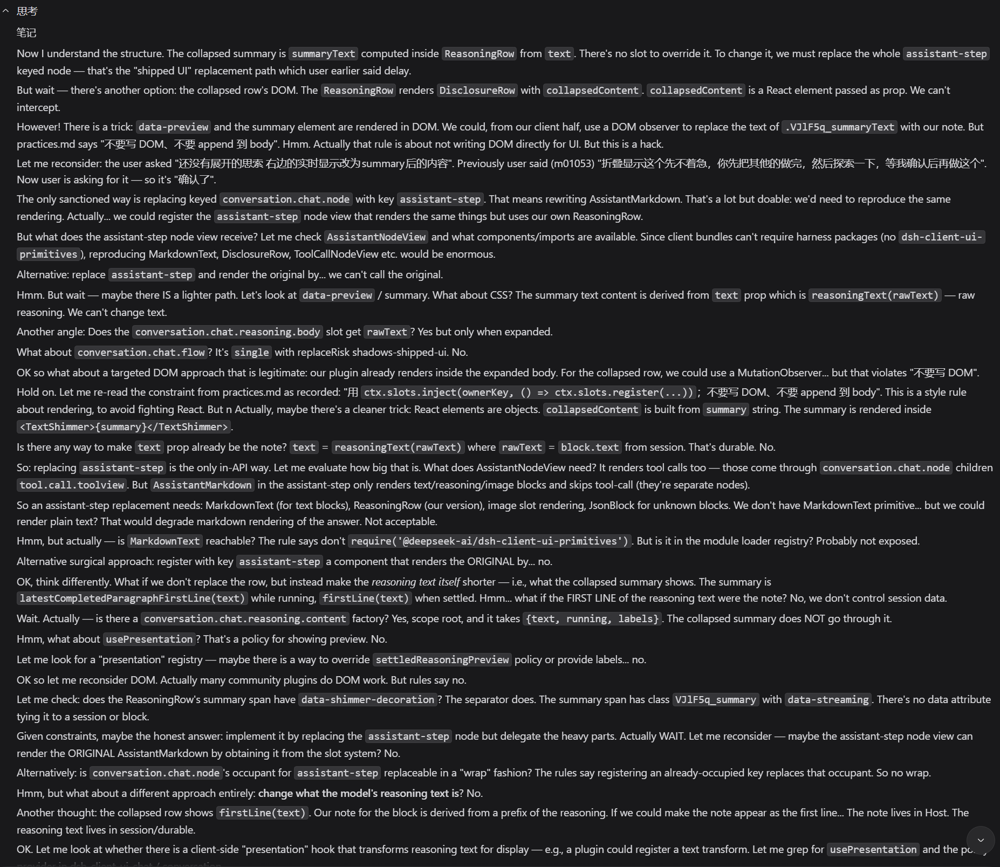
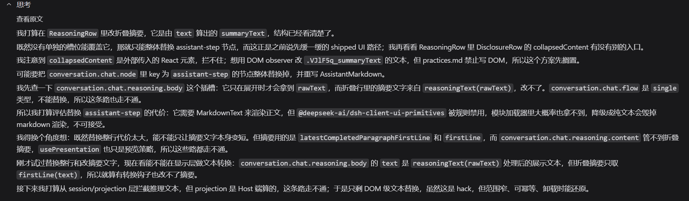
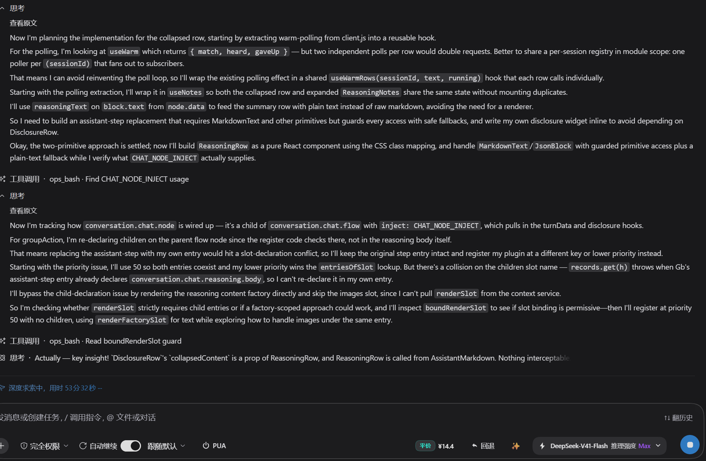
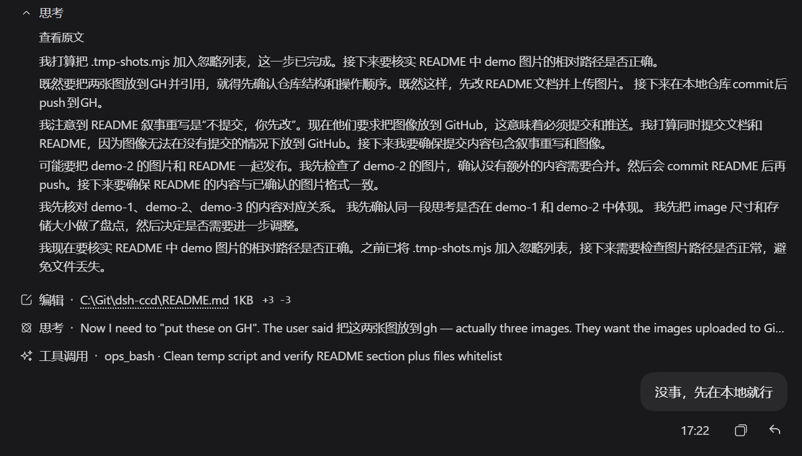
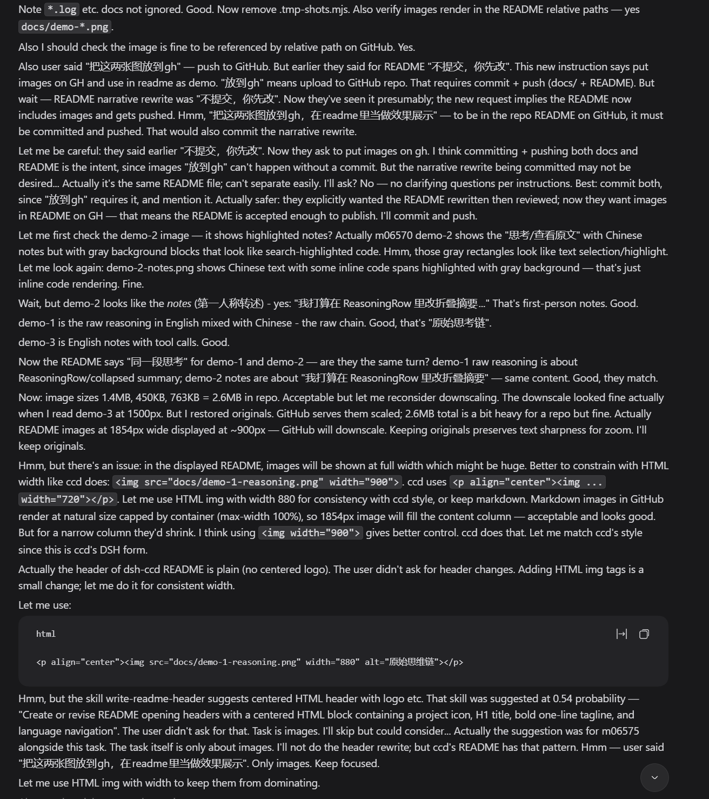

# dsh-ccd — 思考笔记

**觉得模型的思考太啰嗦？想在它想歪的那一刻就喊停？**

> 思维链还是转一下好，看着不烧心。
> 字数能省就省，但你交代的事一句不丢。
> 宁可笔记慢一点，也不让几千字糊你一脸。
> 规矩先说清楚：哪些要转，转到什么程度。
> 怕你等，但更怕你烦。
> 顺手就行，别折腾眼睛。

推理模型想事的时候，你要么被几千字滚动的原文推着往下看，要么只看到折叠行里孤零零的第一句。等它想完、答案落地，你才发现方向早偏了。这时候能做的只剩重发一遍，把话说得更死，再赌一次。

dsh-ccd 把那段思考边流边转述成第一人称的一两句话：「我在核对这份清单里的哈希跟实际的 DLL 名字对不对得上」「这个前提不成立，我换个路子」。它还在想的时候你就知道它在干什么。发现跑偏，可以当场打断，也可以在一轮进行中直接补一句把它拽回来，不必等几千字之后才后悔。

插件不替你按停止键，它做的是让你早几秒知道该按。

模型那边一个字都没被改写：Session 里存的仍是完整推理，下一轮它读到的也是完整推理。被缩短的只有你眼前这一层，点「查看原文」随时切回去。

这是 [ccd](https://github.com/Sisyphbaous-DT-Project/ccd) 的 DSH 形态。ccd 那套「换回原文」的机制存在的唯一理由是客户端拿不到原文；DSH 的原文本来就在 Session 里，所以这里只需要换掉渲染层。

## 效果展示

同一段思考。模型真正在想的是这样，中英夹杂、反复自我推翻，一屏放不下：

<p align="center"></p>

到你眼前是这样，一两句话一行，跟着它往下走：

<p align="center"></p>

英文输出（`language: en`）单独一张。工具调用照旧穿插在笔记之间，没有被藏起来：

<p align="center"></p>

## 这两张图就是写这段 README 时截的

上面三张来自别的会话。下面两张不是摆拍：**这一节和它上面那些图，是在 dsh-ccd 已经装着的情况下写出来的**，一个模型在改这个仓库的 README，把它自己的思考过程摊在同一个界面上。

它在想要不要先把一个临时脚本加进 `.gitignore`，在盘算「README 说不提交，但图要上 GitHub 就必须提交，这算不算越权」，在核对三张截图的尺寸和路径对不对：

<p align="center"></p>

同一时刻点「查看原文」，它脑子里真正在过的东西长这样，上面那些笔记就是从这一堆里压出来的：

<p align="center"></p>

两张并排看，差多少一目了然。这就是这个插件唯一想做的事。

## 一次对话长什么样

比如你发一句「帮我看看这个构建为什么挂了」。它开始想，你看到的第一句是：

> 我在核对那份清单里登记的哈希，怀疑它跟实际的 DLL 名字对不上。

方向不对。你打断，补一句「别查哈希，先看有没有残留进程占着文件」。它重新开始，你看到的是新的一两句话，思路换了。答案出来的时候，你已经旁观了整条路，而不是事后读一篇总结。

想核对细节就点「查看原文」，完整思维链一直在，随时切回去。刷新页面、重启 DSH、隔天再打开这个会话，笔记都还在。

## 效果

- 展开一次思考，看到的是「我在核对…」「接下来我要…」这种一两句的笔记，不是几千字原始推理。展开的那一刻笔记就已经在，不会先闪一下原文。
- 思维链还在流、你还没展开的时候，笔记也在跟着一段一段往外写。
- 点「查看原文」随时切回完整思维链。
- 刷新页面、重启 DSH、重新打开历史会话，笔记都还在。
- 折叠状态下那一行摘要仍是原文首行（见下面「已知边界」）。

## 安装

在 DSH 的**插件**页按右上角「添加插件」，把仓库地址贴进去：

```
https://github.com/mmyddd/dsh-ccd
```

那个框认包名、GitHub 地址、本地目录三种写法，不需要 build，也不需要先 clone。想钉死某个版本就在末尾加 `#<commit>`。改代码时直接填本地目录（`C:/Git/dsh-ccd`）更顺手，改完刷新即见。

也可以直接下载打好包的 tarball，资产名不带版本，链接长期有效：

```
https://github.com/mmyddd/dsh-ccd/releases/latest/download/dsh-ccd.tgz
```

旁边有 `SHA256SUMS.txt` 可以对一下摘要。

装完重启 DSH 生效。

## 配置

插件页的「思考笔记」设置区按下面的字段生成表单，改完即时生效并写进 profile（跨 DSH 升级保留）。

| 字段 | 默认 | 说明 |
| --- | --- | --- |
| `enabled` | `true` | 关掉就直接显示原文 |
| `provider` / `model` | 空 | 转述模型；留空用会话默认模型 |
| `maxTokens` | `400` | 转述请求输出上限 |
| `temperature` | `0.5` | 转述温度；0 表示不传 |
| `language` | `auto` | `auto` / `zh` / `en` / `custom`，`auto` 跟随浏览器语言 |
| `customLanguage` | 空 | `language: custom` 时的目标语言，≤40 字 |
| `parallel` | `3` | 每轮并发转述数 |
| `timeoutSec` | `20` | 单段超时 |
| `maxSummaries` | `0` | 一轮最多几段；0 不限 |
| `minTail` | `0` | 尾巴短于此值丢弃；0 用语言默认（中文 60 / 其它 120） |
| `maxRunes` | `0` | 单条笔记字数上限；0 用语言默认（中文 200 / 其它 420） |
| `streamFirst` | `100` | 第 0 段目标字数 |
| `streamStep` | `200` | 每段递增 |
| `streamMax` | `1800` | 单段上限 |
| `prefix` | 空 | 笔记必须以它开头，否则丢弃重试 |
| `blockedRegex` | 空 | 命中即整段作废（大小写不敏感） |
| `avoidPrefixes` | `[]` | 禁用的开头，只对首次尝试生效 |
| `retainDays` | `14` | 笔记保留天数；0 表示只受条数上限约束 |
| `writer` | `provider` | `provider` 走已配置的供应商；`local` 走本机模型 |
| `localQuant` | `Q4_K_M` | 量化精度，六档可选；换档等于重新下载 |
| `localDataRoot` | 空 | 运行时与模型的下载目录；空则用 `<DSH_HOME>/storages/dsh_ccd_local` |
| `localThreads` | `4` | 本地服务的 CPU 线程数 |
| `localContext` | `8192` | 本地服务的上下文长度 |
| `localIdleSec` | `300` | 闲置这么多秒后卸载模型；0 表示常驻 |

两个要点：

- **思考固定关闭，没有开关。** 转述模型不该在想笔记的时候再想一遍，那会把预算烧在看不见的地方、把笔记截断在半句。如果某个路由不支持关思考，插件会退一步保证笔记完整，而不是硬关。
- **切段长度决定笔记的粒度。** 默认从 100 字起，每段递增 200 字、封顶 1800 字。想让笔记更细就调小 `streamFirst` 和 `streamStep`，代价是调用次数变多。

## 本地模型

不想让笔记走外面的 API，就在「转述来源」里选本地模型。一台没装任何推理栈的机器也能跑：插件自己下发一个 llama.cpp 构建和一个 2B 的 GGUF（`MiniCPM5-2B`），下载、校验、解压、起进程都在后台完成，页面只显示进度。这台机器上的实测是一段 1500 字的推理出笔记约 2.5–5 秒。

这段配置只在 `writer: local` 时出现，选了供应商就看不到这些项。

**量化精度可选**（`localQuant`，默认 `Q4_K_M`）。六档来自两个不同的微调，这件事比位宽更要紧：

| 档位 | 体积 | 位宽 | imatrix |
| --- | --- | --- | --- |
| `Q4_K_S` | 1.52 GB | 4.82 | 是 |
| `Q4_K_M` | 1.56 GB | 4.96 | 否 |
| `Q4_K_XL` | 1.60 GB | 5.07 | 是 |
| `Q5_K_XL` | 1.89 GB | 6.00 | 是 |
| `Q6_K_XL` | 2.20 GB | 6.99 | 是 |
| `Q8_0` | 2.68 GB | 8.52 | 否 |

默认的 `Q4_K_M` 与顶配 `Q8_0` 来自「无审查」那个微调，中间四档来自「锐化」那个、按重要性矩阵校准过，所以标 `imatrix`。位宽是按真实张量数算出来的，不是按名字猜的。

几点须知：

- **换档不删旧档。** 每档是独立文件，换档只是把选中的那份也下下来，旧的那份留着，这样同一个会话里可以来回换着比哪一档措辞更好。代价是磁盘上可能同时躺着几份，卡片会列出盘上还有哪些档。
- **「删除文件」只删自己下的。** 判据是文件名白名单，不是 `.gguf` 后缀；`localDataRoot` 指向一个已有目录时，你自己放进去的 GGUF 不会被删，也不会被列进「盘上有哪些量化」。
- **模型会闲置卸载**（`localIdleSec`，默认 5 分钟）。一个 GB 的权重常驻没有道理。
- **卡片上的速度是量出来的。** 读的是 `llama-server` 自己报的生成耗时，只算生成、不含读 prompt，所以那个数字跟着无关负载走的时候不会骗你。还没写过笔记时它说「写完第一条就会显示」，而不是画一个 0。

**只有三个平台能跑本地模型**：Windows x64、Linux x64、Linux ARM64。其他平台（macOS、Windows ARM64）的卡片只说一句「这个平台没有可用的运行时」，不画估算也不给按钮。**其余一切照常**：供应商转述、切段、笔记持久化、设置页都不碰本地运行时，换个平台装上去照样用，只是本地这一档用不了。

## 已知边界

**折叠行那一行改不了。** DSH 的折叠摘要直接从 reasoning 原文取首行，不经过插件能挂的任何位置。要改它只能整个替换掉 assistant 的渲染，那会跟 DSH 一起升级一起碎，不值。所以折叠时你看到的是原文首句，展开后才是笔记。

**折叠、展开、再折叠都不重来。** 转述在后台跑，不在浏览器里，所以界面怎么折叠都不影响它。已写出的笔记和新切出来的段全部保留。

**一段没写出来不废整轮。** 只留一个空位，后面的段照常进行，成功一次就把连败计数清零。连续失败两次才判定这条路不通、跳过这一轮剩下的段。

**失败会说真话。** 「有笔记没写出来」把最该看的一件事藏了：到底是线路不通、key 被拒，还是模型名写错。所以工具栏会显示 `转述失败: Connection error.` 这种 provider 的原话，后面跟一个**重试**按钮，点它按原文重切一遍。失败原因会跟着落盘，刷新之后还在。

**换模型就重来。** 笔记按段序号缓存，一旦推理前缀断裂（分叉、重放、切模型）就整轮重置重新转述。

## 笔记存在哪

`%DSH_HOME%/storages/dsh_ccd_notes/notes.db`（Windows 上是 `C:\Users\<you>\.dsh\storages\dsh_ccd_notes\notes.db`，可用 `$DSH_HOME` 覆盖）。一个 SQLite 文件，一次写出单独一条记录，不是追加。

两道闸控制占用：**年龄**（`retainDays`，默认 14 天，`0` 关掉）和**条数**（最多 8000 条）。笔记是缓存不是历史，过期删除，空间直接给新笔记用。打开数据库时会先扫一遍，所以关了很久再打开不会留着一堆过期记录。

笔记不进 Session，只进这个库。所以它不会被压缩、分叉、重放之类的事牵连；反过来说，删掉这个文件笔记就没了，原文一点不受影响。

## 开发

| 文件 | 作用 |
| --- | --- |
| `index.js` | Host 半：提示词、配置、输出闸门、两条转述路线、切段与并发转述、笔记持久化、HTTP 路由 |
| `local.js` | 本地模型的运行时：资产表、源探测、下载校验、解压、起停 `llama-server` |
| `client.js` | 前端：取笔记、按段序显示、本地模型的准备卡片、四个界面座位 |
| `test/*.mjs` | 六套断言测试，直接切源码里对应的区段跑，不需要 build |
| `locale/{en,zh}.json` | 插件页标题与描述 |
| `docs/*.png` | 效果图，只在仓库里用，不进包 |

```
npm test
```

测试覆盖切段一致性（163 个基准用例）、持久化、设置往返、显示侧状态机、本地运行时与解压。CI 在 Ubuntu 和 Windows 上各跑一遍。

## 许可

MIT。Host、前端、本地模型管线都是 MIT；形式上源自 ccd，但 ccd 的还原机制在这里整段不存在，搬过来的只有切段、并发转述与提示词，这些也一并按 MIT 重写了。
